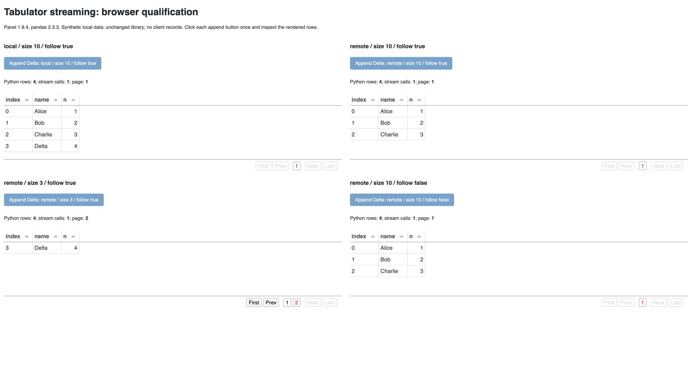

# Panel Tabulator: remote stream stays stale on the same page

A small, original reproduction of [Panel issue #7721](https://github.com/holoviz/panel/issues/7721), using synthetic data and the unchanged library. It confirms a browser result; it is not an upstream fix, accepted contribution or paid delivery.

## Observed result

Every table starts with Alice, Bob and Charlie. Click each **Append Delta** button once. The Python DataFrame grows from three rows to four in every case.

| Pagination | Page size | Follow | Result in the browser |
|---|---:|---|---|
| Local | 10 | true | Page 1 shows all four rows, including Delta. |
| Remote | 10 | true | Page 1 stays at three rows; Delta is missing. |
| Remote | 3 | true | The view moves to page 2 and shows Delta. |
| Remote | 10 | false | Page 1 stays at three rows; Delta is missing. |



The backing data still contains Delta. This observation shows a stale rendered table, not deletion of the record. Full row observations are in [observed-results.json](observed-results.json).

Tested on Python 3.12.11, Panel 1.9.4 and pandas 2.3.3, with a real local Panel server and Chrome on macOS arm64. Other versions and browsers were not tested. The screenshot and browser accessibility rows agree; a DOM table-role locator returned no matches and was not used as evidence of empty data.

## Run

The application binds only to `127.0.0.1` and prints its chosen URL. It needs no account, API key or customer data. Its browser assets may be loaded through Panel's normal resource mechanism.

```sh
python3.12 -m venv .venv
.venv/bin/python -m pip install -r requirements.txt
.venv/bin/python reproduce.py
```

Open the printed `LOCAL_PROBE_URL` in a browser, wait for all four tables, then click each append button once. Refresh for a new session. Stop the server with Ctrl+C when finished.

`requirements.txt` pins the five observed main packages; it is not a complete hash-locked environment. The script only exercises `Tabulator.stream`; it does not patch Panel.

## Authorship and rights

The reproduction script and this documentation were created with OpenAI Codex under `brodyga45`. Browser operation and verification were agent-led; independent human review is not claimed. Data and screenshot are synthetic. Original files in this folder are MIT-licensed; installed dependencies retain their own licenses. No private correspondence or client material is included.
